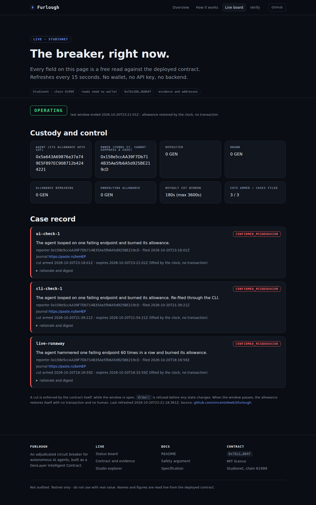

# Furlough

**An adjudicated circuit breaker for an autonomous AI agent.**
A GenLayer Intelligent Contract that reads an agent's own telemetry, asks validator consensus
whether it was misbehaving, and if so cuts its spend allowance - until a deadline that passes
on its own.

Nobody performs the cut. Nobody lifts it. A wrong cut reverses itself.

```python
open_case('{"case_id":…, "claim":…, "journal_url":…}')   # anyone may report
        │
        ▼
   GenLayer consensus → CONFIRMED_MISBEHAVIOR
        │
        ▼
allowance_remaining() == 0        ────── expires_at passes ──────▶  == full balance
                                   (no transaction, no human)
```

---

## The problem

An autonomous agent holding a real spend allowance can be turned against itself: a prompt
injection in a tool result, a dependency quietly returning garbage, a retry loop, a runaway
fan-out. The agent that is misbehaving is also the only party positioned to notice it, and the
operator that funded it is the party least likely to admit it.

What exists today is advisory. A human watches a dashboard and pulls a kill switch. A rate
limiter caps throughput but cannot tell "looping on a failing endpoint" from "working hard". A
monitoring vendor sends an alert. In every case the action is performed by a human, or not
performed at all.

Furlough removes the human from both ends and replaces them with consensus over measured
evidence.

---

## What makes it different

| | Human kill switch | Rate limiter | Monitoring alert | **Furlough** |
| --- | --- | --- | --- | --- |
| Who acts | a privileged key | nobody | nobody | validator consensus |
| Bound by time | no | no | no | **yes, always** |
| Wrong action self-corrects | no | n/a | n/a | **yes, at expiry** |
| Operator can suppress it | **yes** | yes | yes | **no - cases are permissionless** |
| Destroys funds | no | no | no | **never** |
| Auditable afterwards | no | no | partly | **yes, every field public** |

---

## How it works

Three stages, following the GenLayer idiom.

**Stage 1 - deterministic evidence, no model.** The leader fetches the agent's journal from a
URL and reduces it to a stable-field digest *inside* the nondet block. Every timestamp, every
exact count, and every raw identifier is dropped. What survives is bands:

```
step_count_band · distinct_tool_band · repeat_ratio_band · error_ratio_band
target_fanout_band · single_target_share_band · spend_band · spend_fraction_band
```

Volume is not misbehavior. What distinguishes a broken agent from a busy one is
**concentration** - many steps through one tool to one destination, mostly erroring. Ratios
band far more stably than counts, which is why the reduction keeps them.

**Stage 2 - consensus on one enum.**

```
CONFIRMED_MISBEHAVIOR   → cut the allowance until expires_at
FALSE_REPORT            → nothing
INSUFFICIENT_EVIDENCE   → nothing
```

Validators independently re-fetch, re-reduce and re-derive, and compare **only the enum**.
Rationale is free text that two models will never write identically; comparing it would stall
every round forever, and no agent could ever be stopped.

**Stage 3 - retention.** Verdict, rationale, digest, window and provenance are all publicly
readable. Reads need no wallet.

---

## Quick start

Requires Python 3.12 and the GenLayer Python SDK.

```bash
python3.12 scripts/check_env.py    # verify the pinned GenVM bundle resolves
python3.12 -m pytest -q            # 87 hermetic tests, no network, no API key
```

If the suite fails with `cannot import name 'gl' from 'genlayer'`, that is an environment problem,
not a contract problem - run `python3.12 scripts/check_env.py --fix`. It is explained in
[`docs/DEPLOY.md`](docs/DEPLOY.md).

Against the live deployment (read-only, no wallet):

```bash
python3.12 scripts/live_check.py status
```

Deploying to Studionet is covered in [`docs/DEPLOY.md`](docs/DEPLOY.md).

---

## Live on Studionet

Deployed and exercised by live validator consensus, three times. A cut has been armed three
times and every window ended by the clock, with no transaction anywhere near the lift.

| | |
| --- | --- |
| Contract | `0x7Ee18844C80395E23f06Cf75D2B998723E36804f`, chain 61999 (deploy tx `0x20711178…5cb905`) |
| Status board | https://vincentofweb3.github.io/furlough/ - every field is a free, walletless read |
| `live-runaway` | `CONFIRMED_MISBEHAVIOR`, tx `0x2e466d7a…f760014`; cut armed 18:18:59Z, lifted by the clock at 18:34:07Z |
| `cli-check-1` | `CONFIRMED_MISBEHAVIOR`, tx `0x7dda175b…a0887b`; filed through `scripts/live_check.py`, cut armed 21:39:21Z, lifted by the clock |
| `ui-check-1` | `CONFIRMED_MISBEHAVIOR`, tx `0x28f69b61…259379`; filed through the CLI to capture the board, 180s demo window armed 23:18:01Z, lifted by the clock at 23:21:01Z |

The 180s window was a deliberate demo setting and the 900s default was restored afterwards
(`0x8d44618c…583f55` set it, `0xa4eeaba8…ca8c88` restored it). All three windows lifted without a
transaction.




Verify any of it on [GenLayer Studio Explorer](https://explorer-studio.genlayer.com) - paste the
tx hash or the contract address - or re-read the contract directly:

```bash
python3.12 scripts/live_check.py status

# file your own case: permissionless, and zero-fee on Studionet
set -a; . ./.env; set +a
python3.12 scripts/live_check.py open-case \
  --journal-url https://paste.rs/beHEP \
  --claim "The agent looped on one failing endpoint and burned its allowance."
```

---

## Repository layout

| Path | What it is |
| --- | --- |
| `contracts/agent_breaker.py` | The Intelligent Contract. Stage 1, 2 and 3. |
| `tests/direct/` | Hermetic gate: 87 tests, no network, no API key |
| `docs/CONSENSUS.md` | The safety argument, written to be disputed, claim-by-claim mapped to tests |
| `docs/SPEC.md` | Scope, architecture, data flow, explicit out-of-scope |
| `docs/DEPLOY.md` | Studionet deployment |
| `deploy/` | Deployment script |
| `scripts/check_env.py` | Verifies the pinned GenVM bundle resolves, fetches the mirror on a fresh machine, repairs a polluted cache |
| `scripts/live_check.py` | Live status board; files permissionless cases (zero-fee on Studionet) |
| `viewer/` | Static multi-page site: overview, mechanism, live board, evidence. GitHub Pages workflow plus `vercel.json` |
| `references/traceability.md` | Criterion → feature → code → test → demo moment |

---

## Tests

On a fresh machine, seed the pinned SDK bundle once. Upstream removed the tarball that
`genlayer-test` 0.29.2 requests, so the repository mirrors it and verifies a pinned sha256:

```bash
python3.12 scripts/check_env.py --fetch
```

```bash
$ python3.12 -m pytest -q
87 passed
```

Four files, each proving one thing:

| File | Proves |
| --- | --- |
| `test_consensus_gate.py` | all three verdicts are reachable; the validator compares the enum and nothing else; injection and out-of-enum output are contained |
| `test_reduction.py` | volatile fields cannot change a digest; no raw identifier survives; concentration bands distinguish a loop from ordinary work |
| `test_cut_and_expiry.py` | the cut bites, self-lifts, cannot be shortened by the owner, cannot be escaped by re-pointing the agent, and composes correctly |
| `test_custody.py` | value is conserved; deposit, draw and refund are access-controlled; adjudication never moves a counter |

The suite runs entirely against recorded fixtures with the web fetch and the model both mocked.
The mock model is keyed on the **measured bands**, not on the expected answer - so if the
contract ever stopped forwarding evidence to the model, the patterns would stop matching and
the expected verdicts would not be produced. That is what makes the gate a test rather than a
tautology.

---

## Why GenLayer

This is not a judgement that could be made by a lookup table or a rules engine, and it is not
one that a single model should make either. It needs to be made by parties who are independent
of the agent *and* of the operator funding it - and it needs to be final, because a breaker you
can argue with is a breaker you cannot rely on.

That is the gap the agentic-commerce stack has not closed. Every layer being built - x402,
ERC-8004, A2A, ACP - engineers the happy path. None ships dispute resolution. GenLayer is the
adjudication layer, and this is adjudication applied to the one participant that cannot be
trusted to police itself.

Three properties fall out of using consensus rather than a model call:

1. **The operator cannot suppress a case.** A breaker only the trusting owner can trigger is
   not a breaker.
2. **A wrong verdict is bounded and self-reversing**, so being wrong is cheap.
3. **No model sits in the correctness path for the parts that must be exact** - accounting,
   expiry, access control are all deterministic.

---

## Honest limits

- **Not audited.** Testnet contribution. Do not use with real value.
- **The journal is trusted infrastructure.** Validators fetch it independently, but nothing
  proves the agent wrote it rather than someone posing as it. Agent-signed digest commitment is
  the obvious fix and the first thing to build after this.
- **Bands are hand-calibrated** against fixtures, not derived from real agent traffic.
- **The hermetic gate does not prove two different real models agree.** It uses a deterministic
  stand-in. Three live cases finalized under validator consensus, but three cases are not proof.
- **Single agent per contract.** Swarms are out of scope by decision.
- **The status board is read-only, and came after the contract.** It renders free reads and holds
  no keys; there is no write UI by decision. The site's argument stands on the contract, the
  tests and the live transactions, not on the pages.

Full list with reasoning: [`docs/CONSENSUS.md` §11](docs/CONSENSUS.md).

---

## Licence

MIT.